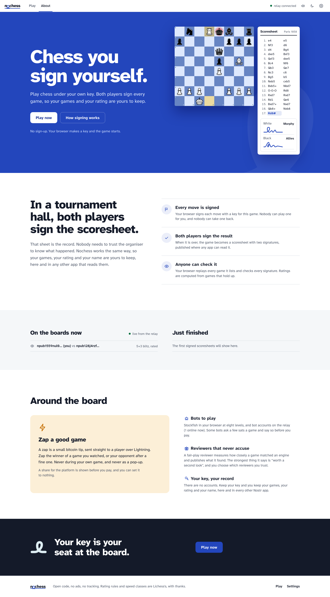
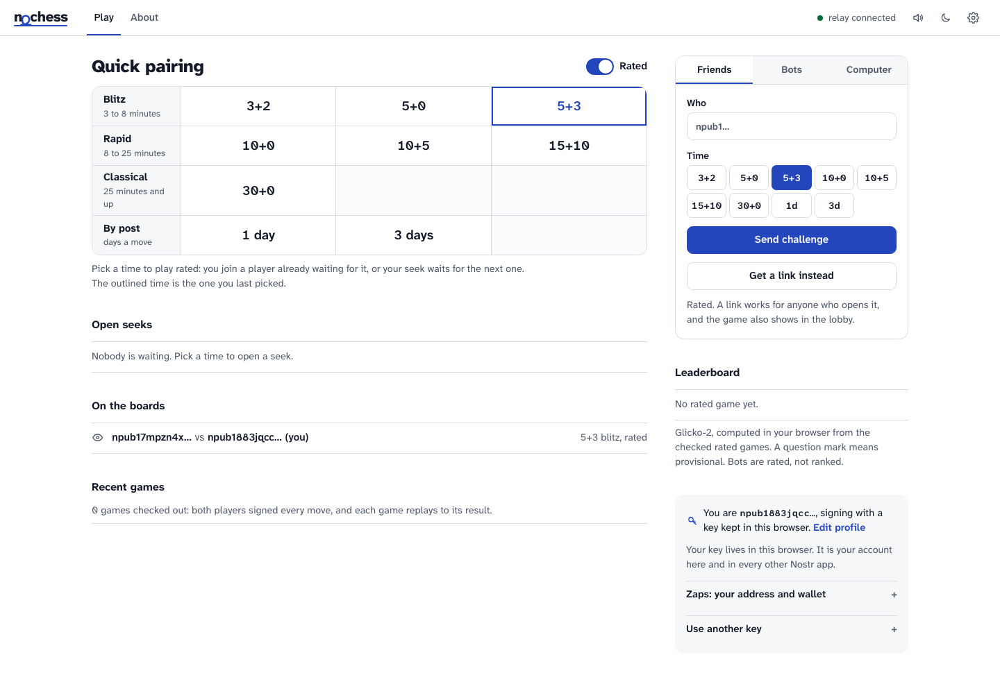
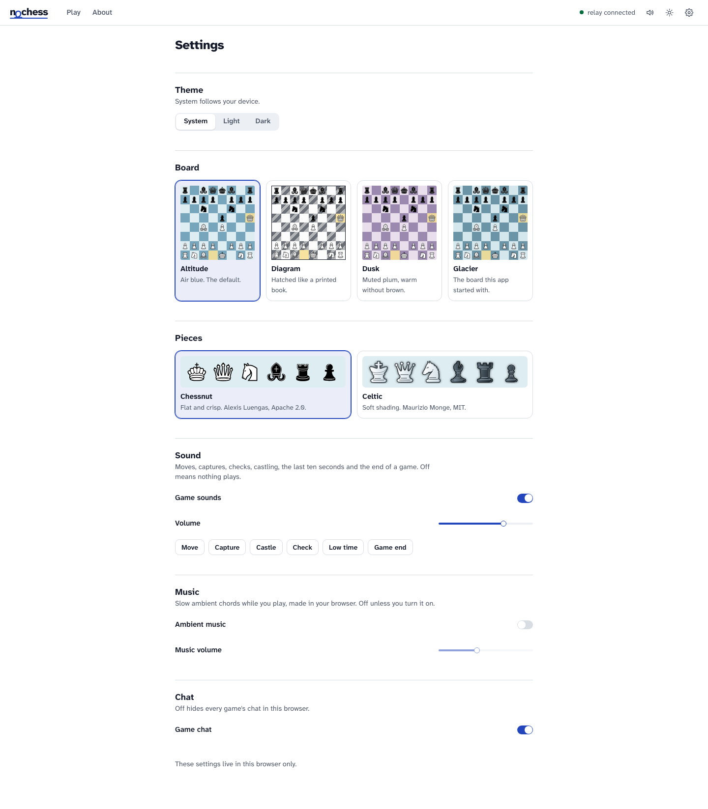
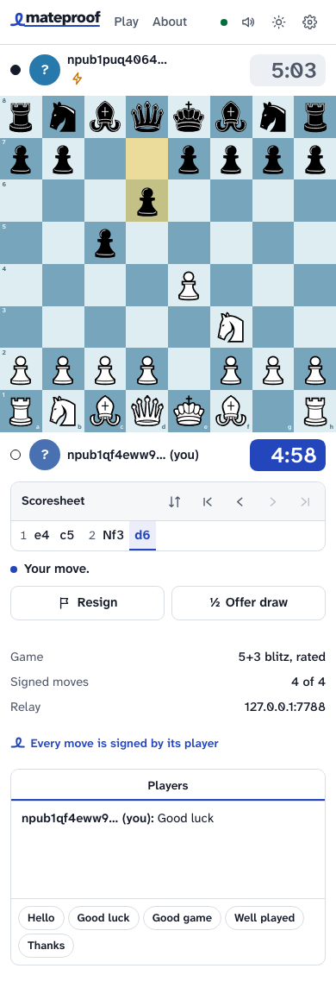
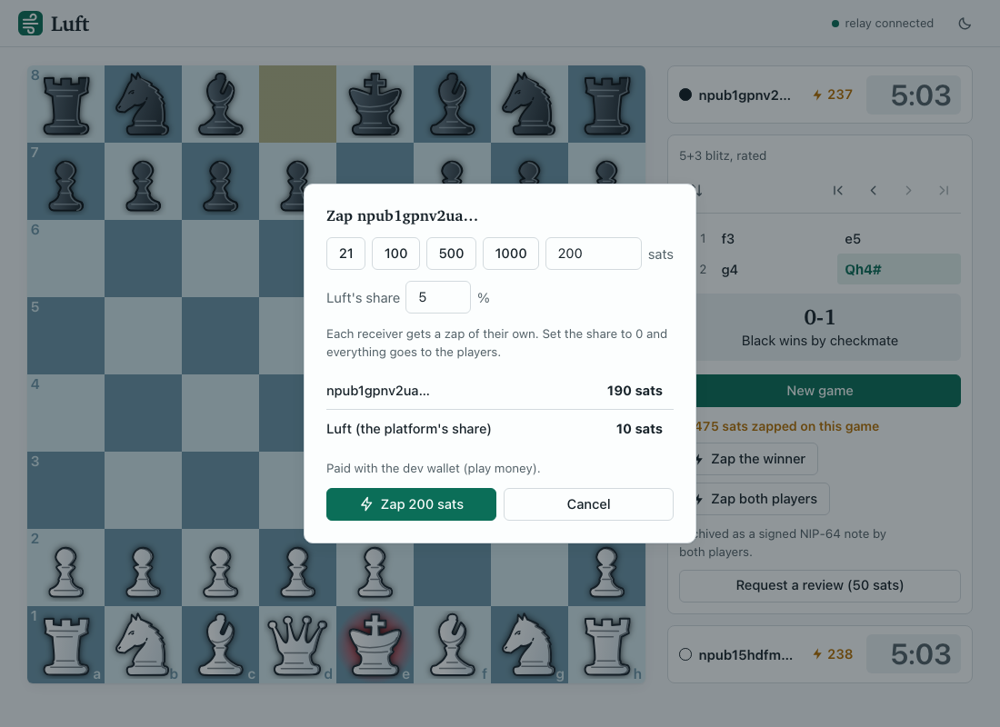
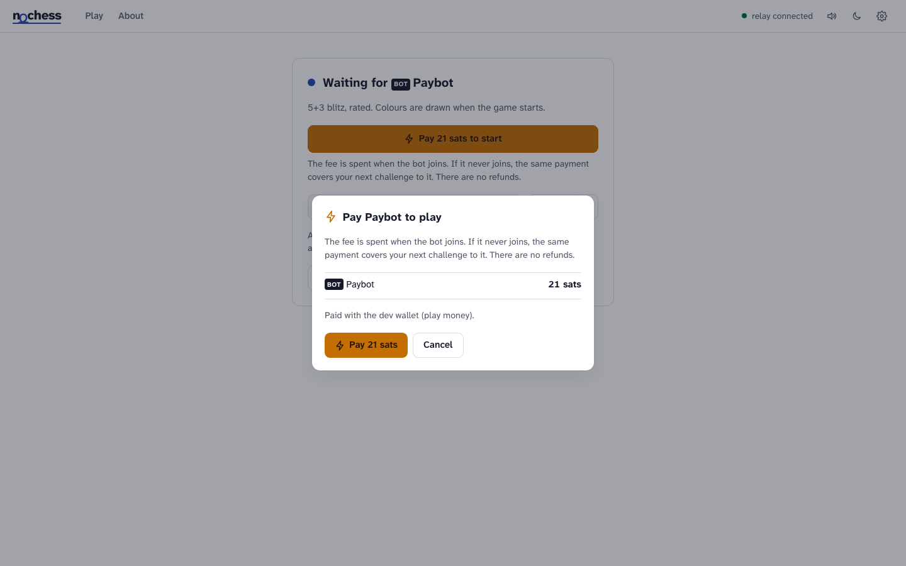
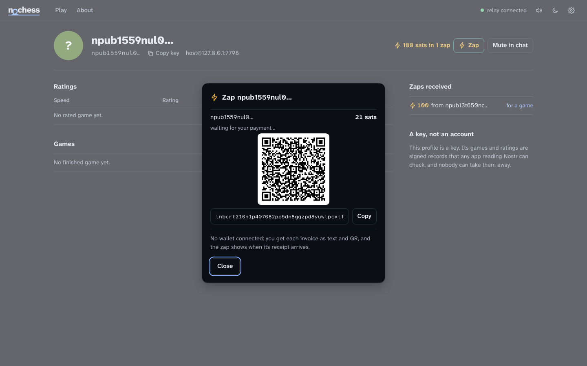

# Nochess

Chess between Nostr keys. Two people play a clocked game by publishing signed events to a relay; anyone can watch, and every finished game becomes a NIP-64 note that proves itself. There is no game server.

It is served at https://anchorman-lol.github.io/nochess/, playing on wss://relay.anchorman.lol.

## Run it

```sh
pnpm install
pnpm dev        # relay on ws://127.0.0.1:7778, bots, a reviewer, a mock Lightning provider, and the app on http://127.0.0.1:5174
```

Open the app in two browsers (or one normal and one private window) to play yourself. The relay binary is built once from `~/work/anchorman-relay` into `.relay-bin/`.

`pnpm dev` also starts a mock Lightning provider on `127.0.0.1:7779`, so zaps and fees work with play money: Nochess bot is free, Nochess bot Pro plays for 21 sats, the reviewer reviews a game for 50. To be zapped yourself, open "Zaps: your address and wallet" in the lobby and save any `name@127.0.0.1:7779`.

| Command               | What it does                                                                                                                                                                                                |
| --------------------- | ----------------------------------------------------------------------------------------------------------------------------------------------------------------------------------------------------------- |
| `pnpm dev`            | Relay, mock Lightning provider, a free and a paid bot, the paid reviewer and the Vite dev server                                                                                                            |
| `pnpm bot`            | A bot account alone. `NOCHESS_BOT_SKILL` (0 to 20), `NOCHESS_BOT_MS` per move, `NOCHESS_BOT_NAME`; to charge, `NOCHESS_BOT_PRICE` in sats and `NOCHESS_BOT_LUD16`                                           |
| `pnpm review`         | The automated fair-play reviewer: analyses finished games and publishes NIP-32 labels. `--dry` prints only, `--include-bots` reviews declared bots too                                                      |
| `pnpm review --serve` | The same reviewer on request: reviews a game once a zap of `NOCHESS_REVIEW_PRICE` sats (default 50) to `NOCHESS_REVIEW_LUD16` names it                                                                      |
| `pnpm zapmock`        | The mock Lightning provider alone, on `NOCHESS_ZAP_PORT` (default 7779)                                                                                                                                     |
| `pnpm rate`           | The reference Glicko-2 rater: publishes one checkable assertion per player. `--dry` prints only, `--watch` keeps rating, `--pubkey` prints its key                                                          |
| `pnpm test`           | Unit tests: replay, clock, archive audit, ratings, reviewer statistics, zap receipts, splits and fee gating, settings, sounds and chat rules                                                                |
| `pnpm test:e2e`       | Playwright: two browsers play a full game and chat, one plays the bot accounts to the end, players are zapped, a bot and a reviewer are paid                                                                |
| `pnpm shots`          | Screenshots of the landing page, lobby, game, settings, the profile editor, the relay list, a zap, a paid bot and an invoice at 1440 and 390 px, light and dark, into `SHOTS_DIR`; fails on a console error |
| `pnpm check`          | Lint, format check, typecheck, unit tests and e2e                                                                                                                                                           |

The tools read `NOCHESS_RELAY` (default `ws://127.0.0.1:7778`) and keep their keys in `.keys/`. A second bot needs a key of its own: `NOCHESS_BOT_ID=name` keeps it in `.keys/name.hex`. `NOCHESS_BOT_SPEEDS` (`blitz,rapid`) and `NOCHESS_BOT_MODES` (`rated,casual`) limit what a bot plays. A bot keeps the keys of its games in `.keys/<id>-sessions.json`, so after a restart it carries on with the games it sits in; it takes at most `NOCHESS_BOT_TABLES` (default 15) games and challenges at once, since relays cap subscriptions per connection, and declines the rest.

## What is in it

- Seeks and direct challenges, blitz, rapid, classical and correspondence. No bullet. A seek can be withdrawn, and a quick-pairing tile seeks from the lobby. Nothing waits for ever: a seek or challenge withdraws itself when its countdown runs out, and a bot declines what it can't take.
- Clocks from event timestamps, resign, draw by agreement, abort, automatic time claims. Each first move has Lichess's short limit; a game whose first move doesn't come is aborted, unrated, on the side that didn't move.
- A reliability record for every bot and player (challenges answered, time to answer, games abandoned), from public events, also published by the rater, and a price cap for bots without one.
- Spectating by link, and a chat per game: the players talk freely, with quick phrases a tap away; spectators have a room of their own that players see once the game is over.
- Full lists of games, live boards, open seeks and the leaderboard, loading older ones from the relay as you scroll.
- A signed archive of every finished game and a results list that shows only games whose every signature verifies.
- The computer in the browser (Stockfish WASM, eight levels, casual) and a bot account that plays rated games over the relay.
- Glicko-2 ratings per speed class: published by a rater the client trusts (`VITE_RATERS`), verifiable from a player's page, and computed in the browser where no rater has spoken.
- Zaps (NIP-57) to a player, or to one or both players of a game, with the receipts shown on the cards. Paid by WebLN, Nostr Wallet Connect, or as an invoice with a QR code.
- Bots and reviewers that charge per game, and act only on a receipt they have verified.
- Settings kept in the browser: theme, four boards (Altitude, Diagram, Dusk, Glacier), two piece sets, game sounds with a volume, ambient music (off by default) and chat.
- A landing page at `#/about`, shown at `#/` until the first visit to the lobby (`#/play`).

## Zaps and fees

Zaps go from the payer's wallet to the recipient's lightning address. Nochess holds no money, and nothing paid depends on who wins: there are no stakes, wagers or prize pools.

A zap can give a share to the platform. The dialog shows who gets what before anything is paid, the share is 15% unless the build sets `VITE_PLATFORM_SHARE` or the payer changes it, and 0 sends everything to the players. Each receiver is paid by an invoice of their own. Fees to a bot or reviewer are not split.

A paid bot's fee is spent when the bot joins the challenge. If it never joins, the same payment covers your next challenge to it. There are no refunds.

### Real Lightning

The mock provider and the play-money wallet exist only where `VITE_DEV_WALLET` is set. For real sats:

1. Build or serve the app without `VITE_DEV_WALLET`. Payers then use their own WebLN wallet or Nostr Wallet Connect link, or scan the invoice.
2. For a share, set `VITE_PLATFORM_LUD16` to the platform's lightning address and `VITE_PLATFORM_PUBKEY` to the hex key the share is zapped to, and optionally `VITE_PLATFORM_SHARE` (percent, default 15). Leave them unset for no share. The Pages build reads them from `apps/web/.env.production`.
3. Give each service a lightning address at a provider that supports NIP-57 zaps (its LNURL endpoint says `allowsNostr`): `NOCHESS_BOT_LUD16` with `NOCHESS_BOT_PRICE`, `NOCHESS_REVIEW_LUD16` with `NOCHESS_REVIEW_PRICE`.
4. Use a relay the providers can reach, since they publish the receipts to it, and don't start `tools/zapmock.ts`.

## Deploy

Every push to `main` builds the app and deploys it to GitHub Pages (`.github/workflows/pages.yml`); `gh workflow run pages.yml` redeploys `main` by hand. The build takes its settings only from `apps/web/.env.production`, and CI runs no tests. Asset paths are relative and routes are hash-based, so the same build works under any path.

`deploy/services.sh` runs the rater (`--watch`) and the paid reviewer (`--serve`) as systemd services `nochess@rater` and `nochess@reviewer` on a Debian host, with their settings in `deploy/*.env`; `STOCKFISH` points the tools at a native engine instead of the WASM build.

How it works, the event kinds, and what the relay still has to enforce: [docs/DESIGN.md](docs/DESIGN.md).

## Layout

A pnpm workspace.

- `apps/web/` the web client: React and Vite. `src/app/store.ts` holds the routes and their state, `src/pages/` and `src/components/` render them, `src/lib/` has settings, sounds and board helpers, `src/chat/` the chat rules.
- `packages/core/` everything that isn't UI, shared by the client and the tools: `game/` the rules as pure functions (`replay`, `archive`, `glicko`, `review`) and `Table`, one game from a participant's side; `nostr/` the relay connection; `zap/` receipt validation, splits, fee gating and the LNURL client; `engine/` a UCI wrapper for Stockfish.
- `packages/ui/` shadcn/ui components (base-ui), the Tailwind CSS v4 theme with the brand's OKLCH tokens, the logo, and `brand.ts`, the one place the product's name lives. Protocol identifiers (the `nochess` topic tag, `nochess:` storage keys, `NOCHESS_` env vars, the `@nochess/` scope) don't follow it: changing them splits the app from its events and stored keys.
- `tools/` the bot account, reviewer, rater and the mock Lightning provider
- `e2e/` Playwright tests, and `shots.ts` for the screenshots

## Playing

Drag a piece or click it and then its square; dots show where it can go. Moving while the opponent is to move sets a premove, played as soon as it is legal. A pawn reaching the last rank asks which piece it becomes. The arrow keys step through the moves (up and down jump to the start and end), `f` flips the board and Escape lets go of a piece. The header switches sounds and music together and the theme, and its relay status opens the list of relays to use, kept in the browser; a shared game link still picks its own relay for its tab. Your profile (name, picture, about, lightning address) is edited under Settings, merged into your existing Nostr profile; the board, pieces, volumes, music and chat are there too.

Sounds and music are synthesised in the browser with Web Audio (`apps/web/src/lib/audio.ts`): there are no audio files. With sounds off nothing plays, and motion follows the system's reduced-motion setting.

| Landing                      | Lobby                    | Settings                       |
| ---------------------------- | ------------------------ | ------------------------------ |
|  |  |  |

| Game, light                  | Game, dark                  | On a phone                     |
| ---------------------------- | --------------------------- | ------------------------------ |
|  |  |  |

| Zapping both players | A bot that charges             | Paying without a wallet      |
| -------------------- | ------------------------------ | ---------------------------- |
|  |  |  |

## Licences

Nochess's own code is MIT ([LICENSE](LICENSE)). The third-party parts below keep their own licences.

Chess rules come from chess.js (BSD-2-Clause). Stockfish is GPL-3 and is loaded as a separate program, in a worker or a child process. The browser build is the unmodified `stockfish-19-lite-single` from the [stockfish](https://www.npmjs.com/package/stockfish) npm package 19.0.1, whose source is at [nmrugg/stockfish.js](https://github.com/nmrugg/stockfish.js) and [official-stockfish/Stockfish](https://github.com/official-stockfish/Stockfish); its licence is served next to it as `engine/COPYING.txt`. In `apps/web/public/`: the Chessnut pieces (`pieces/chessnut/`) are Alexis Luengas's, Apache 2.0 (`pieces/chessnut/LICENSE.txt`); the Celtic pieces (`pieces/celtic/`) are Maurizio Monge's from [maurimo/chess-art](https://github.com/maurimo/chess-art), MIT (`pieces/celtic/LICENSE`), recoloured (`pieces/celtic/NOTICE.txt`); Atkinson Hyperlegible Next and Mono (`fonts/`) are under the SIL Open Font License (`fonts/OFL-*.txt`). The sounds are generated in code, so they carry no licence of their own. The other runtime dependencies (React, nostr-tools, the noble and scure crypto, Base UI, motion, lucide) are under MIT, ISC, Apache 2.0, 0BSD or the Unlicense.
