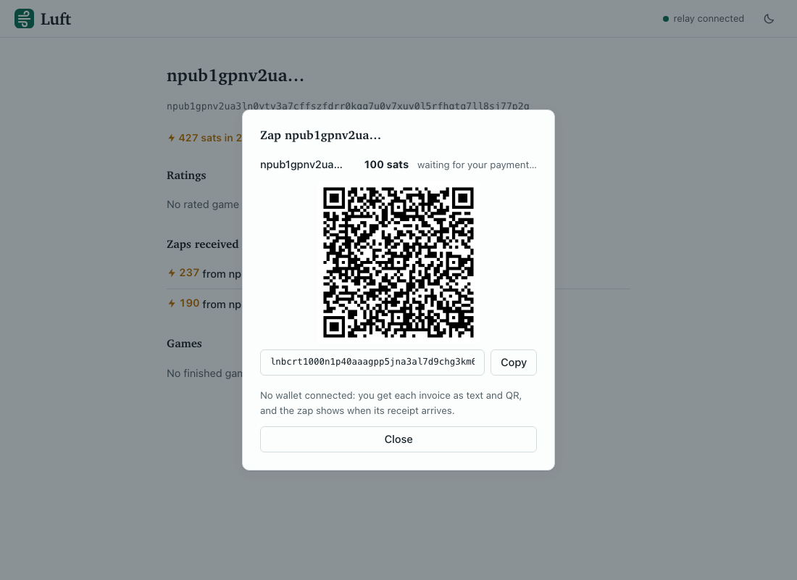

# Luft

Chess between Nostr keys. Two people play a clocked game by publishing signed events to a relay; anyone can watch, and every finished game becomes a NIP-64 note that proves itself. There is no game server.

Local only for now: nothing is deployed or published.

## Run it

```sh
pnpm install
pnpm dev        # relay on ws://127.0.0.1:7778, bots, a reviewer, a mock Lightning provider, and the app on http://127.0.0.1:5174
```

Open the app in two browsers (or one normal and one private window) to play yourself. The relay binary is built once from `~/work/anchorman-relay` into `.relay-bin/`.

`pnpm dev` also starts a mock Lightning provider on `127.0.0.1:7779`, so zaps and fees work with play money: Luftbot is free, Luftbot Pro plays for 21 sats, the reviewer reviews a game for 50. To be zapped yourself, open "Zaps: your address and wallet" on the home page and save any `name@127.0.0.1:7779`.

| Command               | What it does                                                                                                                                           |
| --------------------- | ------------------------------------------------------------------------------------------------------------------------------------------------------ |
| `pnpm dev`            | Relay, mock Lightning provider, a free and a paid bot, the paid reviewer and the Vite dev server                                                       |
| `pnpm bot`            | A bot account alone. `LUFT_BOT_SKILL` (0 to 20), `LUFT_BOT_MS` per move, `LUFT_BOT_NAME`; to charge, `LUFT_BOT_PRICE` in sats and `LUFT_BOT_LUD16`     |
| `pnpm review`         | The automated fair-play reviewer: analyses finished games and publishes NIP-32 labels. `--dry` prints only, `--include-bots` reviews declared bots too |
| `pnpm review --serve` | The same reviewer on request: reviews a game once a zap of `LUFT_REVIEW_PRICE` sats (default 50) to `LUFT_REVIEW_LUD16` names it                       |
| `pnpm zapmock`        | The mock Lightning provider alone, on `LUFT_ZAP_PORT` (default 7779)                                                                                   |
| `pnpm rate`           | The reference Glicko-2 rater: publishes one assertion per player. `--dry` prints only                                                                  |
| `pnpm test`           | Unit tests: replay, clock, archive audit, ratings, reviewer statistics, zap receipts, splits and fee gating                                            |
| `pnpm test:e2e`       | Playwright: two browsers play a full game, one plays the bot accounts to the end, players are zapped, a bot and a reviewer are paid                    |
| `pnpm check`          | Lint, typecheck, unit tests and e2e                                                                                                                    |

The tools read `LUFT_RELAY` (default `ws://127.0.0.1:7778`) and keep their keys in `.keys/`. A second bot needs a key of its own: `LUFT_BOT_ID=name` keeps it in `.keys/name.hex`. `LUFT_BOT_SPEEDS` (`blitz,rapid`) and `LUFT_BOT_MODES` (`rated,casual`) limit what a bot plays.

## What is in it

- Seeks and direct challenges, blitz, rapid, classical and correspondence. No bullet. A seek can be withdrawn, and a quick-pairing tile seeks from the lobby.
- Clocks from event timestamps, resign, draw by agreement, abort, automatic time claims.
- Spectating by link.
- A signed archive of every finished game and a results list that shows only games whose every signature verifies.
- The computer in the browser (Stockfish WASM, eight levels, casual) and a bot account that plays rated games over the relay.
- Glicko-2 ratings per speed class, computed from the audited games.
- Zaps (NIP-57) to a player, or to one or both players of a game, with the receipts shown on the cards. Paid by WebLN, Nostr Wallet Connect, or as an invoice with a QR code.
- Bots and reviewers that charge per game, and act only on a receipt they have verified.

## Zaps and fees

Zaps go from the payer's wallet to the recipient's lightning address. Luft holds no money, and nothing paid depends on who wins: there are no stakes, wagers or prize pools.

A zap can give a share to the platform. The dialog shows who gets what before anything is paid, the share is 5% unless the payer changes it, and 0 sends everything to the players. Each receiver is paid by an invoice of their own. Fees to a bot or reviewer are not split.

A paid bot's fee is spent when the bot joins the challenge. If it never joins, the same payment covers your next challenge to it. There are no refunds.

### Real Lightning

The mock provider and the play-money wallet exist only where `VITE_DEV_WALLET` is set. For real sats:

1. Build or serve the app without `VITE_DEV_WALLET`. Payers then use their own WebLN wallet or Nostr Wallet Connect link, or scan the invoice.
2. For a share, set `VITE_PLATFORM_LUD16` to the platform's lightning address and `VITE_PLATFORM_PUBKEY` to the hex key the share is zapped to. Leave them unset for no share.
3. Give each service a lightning address at a provider that supports NIP-57 zaps (its LNURL endpoint says `allowsNostr`): `LUFT_BOT_LUD16` with `LUFT_BOT_PRICE`, `LUFT_REVIEW_LUD16` with `LUFT_REVIEW_PRICE`.
4. Use a relay the providers can reach, since they publish the receipts to it, and don't start `tools/zapmock.ts`.

| A zap with the platform's share | A bot that charges             | Without a wallet                 |
| ------------------------------- | ------------------------------ | -------------------------------- |
|             |  |  |

A game with zaps and a paid review: [docs/zapped-game.png](docs/zapped-game.png). A player's page: [docs/player.png](docs/player.png).

How it works, the event kinds, and what the relay still has to enforce: [docs/DESIGN.md](docs/DESIGN.md).

## Layout

- `src/game/` the rules of a game as pure functions (`replay`, `archive`, `glicko`, `review`) and `Table`, one game from a participant's side
- `src/nostr/` the relay connection, for browsers and Node
- `src/zap/` zaps: receipt validation, splits and fee gating as pure functions, the LNURL client, wallets and the zap dialog
- `src/engine/` a UCI wrapper for Stockfish
- `src/ui/`, `src/main.ts` the web client
- `tools/` the bot account, reviewer, rater and the mock Lightning provider
- `e2e/` Playwright tests

## Playing

Drag a piece or click it and then its square; dots show where it can go. Moving while the opponent is to move sets a premove, played as soon as it is legal. A pawn reaching the last rank asks which piece it becomes. The arrow keys step through the moves (up and down jump to the start and end), `f` flips the board and Escape lets go of a piece. The moon and sun in the header switch between the dark and light themes.

| Lobby                   | Game, light                  | Game, dark                  |
| ----------------------- | ---------------------------- | --------------------------- |
|  |  |  |

On a phone: [light](docs/game-mobile-light.png), [dark](docs/game-mobile-dark.png), [lobby](docs/home-mobile.png). A finished game: [docs/game-over.png](docs/game-over.png). Waiting for an opponent: [docs/waiting.png](docs/waiting.png). The lobby in the dark: [docs/home-dark.png](docs/home-dark.png).

## Licences

Chess rules come from chess.js (BSD). Stockfish is GPL-3 and is loaded as a separate program, in a worker or a child process. The pieces in `public/pieces/` are Maurizio Monge's Celtic set from [maurimo/chess-art](https://github.com/maurimo/chess-art), MIT (`public/pieces/LICENSE`), recoloured for Luft.
