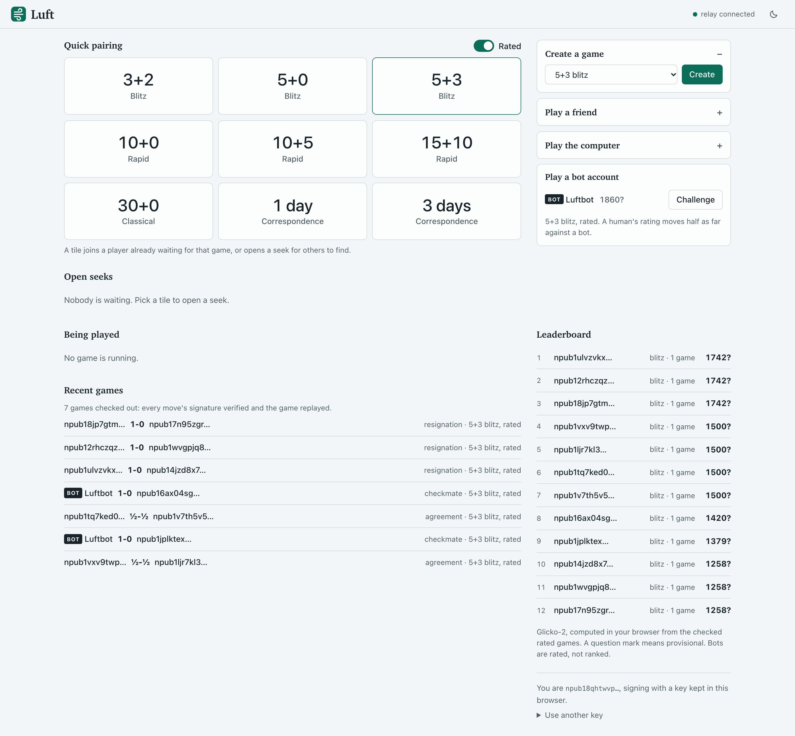
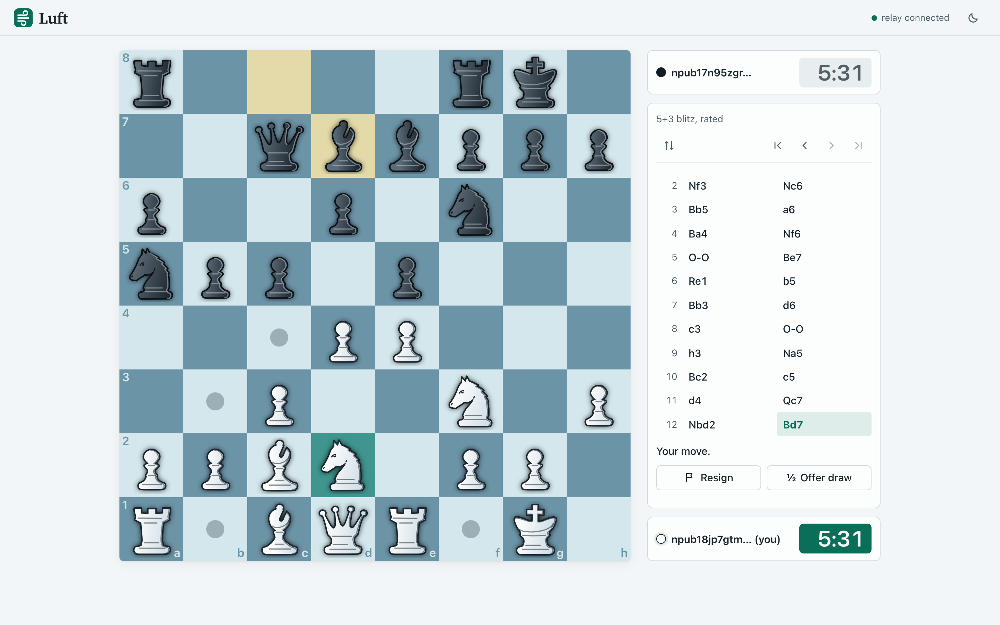
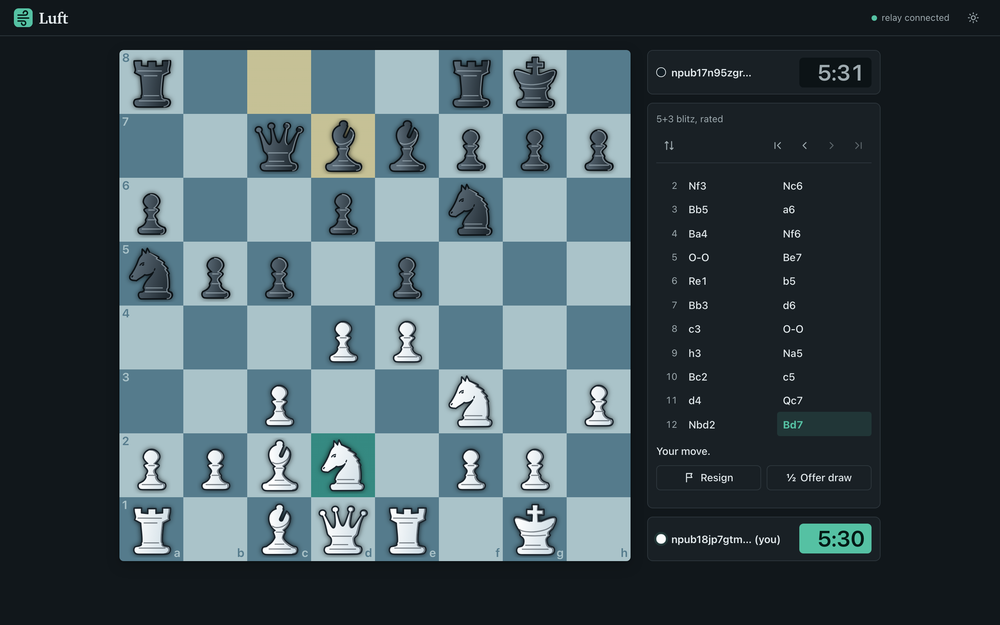

# Luft

Chess between Nostr keys. Two people play a clocked game by publishing signed events to a relay; anyone can watch, and every finished game becomes a NIP-64 note that proves itself. There is no game server.

Local only for now: nothing is deployed or published.

## Run it

```sh
pnpm install
pnpm dev        # relay on ws://127.0.0.1:7778, the bot account, and the app on http://127.0.0.1:5174
```

Open the app in two browsers (or one normal and one private window) to play yourself. The relay binary is built once from `~/work/anchorman-relay` into `.relay-bin/`.

| Command         | What it does                                                                                                                                           |
| --------------- | ------------------------------------------------------------------------------------------------------------------------------------------------------ |
| `pnpm dev`      | Relay, bot account and Vite dev server                                                                                                                 |
| `pnpm bot`      | The bot account alone. `LUFT_BOT_SKILL` (0 to 20), `LUFT_BOT_MS` per move, `LUFT_BOT_NAME`                                                             |
| `pnpm review`   | The automated fair-play reviewer: analyses finished games and publishes NIP-32 labels. `--dry` prints only, `--include-bots` reviews declared bots too |
| `pnpm rate`     | The reference Glicko-2 rater: publishes one assertion per player. `--dry` prints only                                                                  |
| `pnpm test`     | Unit tests: replay, clock, archive audit, ratings, reviewer statistics                                                                                 |
| `pnpm test:e2e` | Playwright: two browsers play a full game, one browser plays the bot account to the end                                                                |
| `pnpm check`    | Lint, typecheck, unit tests and e2e                                                                                                                    |

The tools read `LUFT_RELAY` (default `ws://127.0.0.1:7778`) and keep their keys in `.keys/`.

## What is in it

- Seeks and direct challenges, blitz, rapid, classical and correspondence. No bullet.
- Clocks from event timestamps, resign, draw by agreement, abort, automatic time claims.
- Spectating by link.
- A signed archive of every finished game and a results list that shows only games whose every signature verifies.
- The computer in the browser (Stockfish WASM, eight levels, casual) and a bot account that plays rated games over the relay.
- Glicko-2 ratings per speed class, computed from the audited games.

How it works, the event kinds, and what the relay still has to enforce: [docs/DESIGN.md](docs/DESIGN.md).

## Layout

- `src/game/` the rules of a game as pure functions (`replay`, `archive`, `glicko`, `review`) and `Table`, one game from a participant's side
- `src/nostr/` the relay connection, for browsers and Node
- `src/engine/` a UCI wrapper for Stockfish
- `src/ui/`, `src/main.ts` the web client
- `tools/` the bot account, reviewer and rater
- `e2e/` Playwright tests

## Playing

Drag a piece or click it and then its square; dots show where it can go. Moving while the opponent is to move sets a premove, played as soon as it is legal. A pawn reaching the last rank asks which piece it becomes. The arrow keys step through the moves (up and down jump to the start and end), `f` flips the board and Escape lets go of a piece. The moon and sun in the header switch between the dark and light themes.

| Lobby                   | Game, light                  | Game, dark                  |
| ----------------------- | ---------------------------- | --------------------------- |
|  |  |  |

On a phone: [light](docs/game-mobile-light.png), [dark](docs/game-mobile-dark.png), [lobby](docs/home-mobile.png). A finished game: [docs/game-over.png](docs/game-over.png). Waiting for an opponent: [docs/waiting.png](docs/waiting.png). The lobby in the dark: [docs/home-dark.png](docs/home-dark.png).

## Licences

Chess rules come from chess.js (BSD). Stockfish is GPL-3 and is loaded as a separate program, in a worker or a child process. The pieces in `public/pieces/` are Maurizio Monge's Celtic set from [maurimo/chess-art](https://github.com/maurimo/chess-art), MIT (`public/pieces/LICENSE`), recoloured for Luft.
